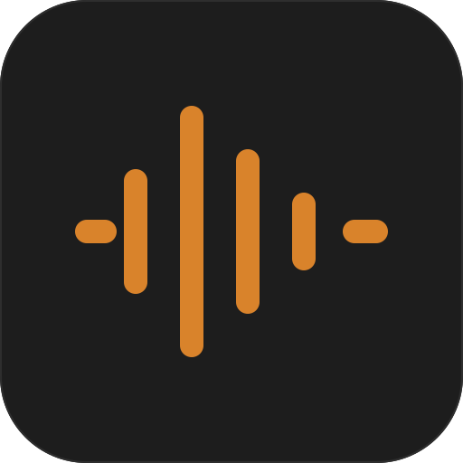
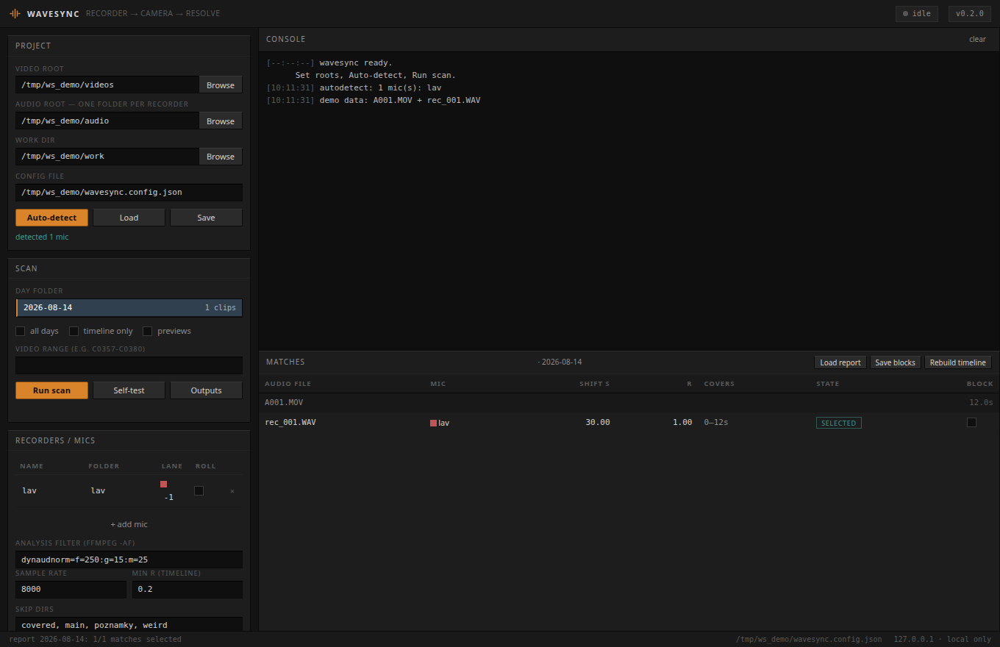

<p align="center">
  
</p>

<h1 align="center">wavesync</h1>

<p align="center">
  Sync external recorder audio to camera footage automatically.<br>
  Waveform correlation in, an FCPXML timeline for DaVinci Resolve out —
  every clip at its true position, each recorder on its own track.
</p>

<p align="center">
  <a href="#features">Features</a> ·
  <a href="#install">Install</a> ·
  <a href="#usage">Usage</a> ·
  <a href="#web-ui">Web UI</a> ·
  <a href="#how-it-works">How it works</a> ·
  <a href="CHANGELOG.md">Changelog</a>
</p>

<p align="center">
  <a href="https://github.com/Dvorinka/wavesync/actions/workflows/ci.yml"></a>
  
  
  
</p>

## What is wavesync?

wavesync solves the classic field-recording headache: the camera rolls in
takes while lavs and prop mics start, stop, and restart on their own clocks.
Instead of syncing hundreds of clips by hand, wavesync finds which recording
covers each video by waveform correlation, reconstructs continuous recorder
sessions even when a recorder's clock is wildly wrong, and writes a timeline
Resolve imports directly — camera audio intact underneath.



## Features

- **Two-stage waveform matching** — spectral-flux onset envelopes nominate
  candidates at speed; raw-waveform Pearson probes at energetic moments
  (clapperboards, door slams) verify them for real.
- **Every camera, every file** — any container ffprobe reads: MOV, MXF, MTS,
  MP4, AVI, MKV… for video; WAV, BWF, MP3, FLAC, M4A, AIFF, OGG, OPUS… for
  audio. Nested card dumps (AVCHD `STREAM/` and friends) are traversed.
- **Broken-clock tolerant** — files stamped 1999 or 2029 still match;
  timestamps are used only when they are sane.
- **Rolling sessions** — a recorder left running through several takes is
  detected as one file spanning multiple clips, referenced at true offsets.
- **Playback-echo rejection** — in-scene playback re-records earlier takes;
  temporal-consistency and coverage checks keep the real file.
- **Quiet audio** — analysis decodes run through `dynaudnorm`, so
  whisper-level lavs correlate. Source files are never modified.
- **True positions, real gaps** — clips never shift to fit; genuine overlaps
  drop to a lower lane.
- **Continuity fill** — `[CONT]` markers where a proven rolling recorder was
  demonstrably running but too quiet to verify.
- **Orphan parking** — audio recorded during a take that didn't match gets
  parked on a spare lane; the rest lands in the project bin.
- **Corrections that stick** — `reports/<DAY>_blocks.json` survives
  regeneration; rejected matches never resurrect.
- **Zero-dependency web UI** — folder picking, autodetect, live scan logs,
  match review and blocks, all local to `127.0.0.1`.

## How it works

```
camera clip A001.MOV ──┐
                      ├─▶ decode mono @8kHz (dynaudnorm, cached)
recorder rec_001.WAV ─┘        │
                               ▼
              1. onset-envelope cross-correlation ──▶ candidates
                               │
                               ▼
              2. raw Pearson probes at energy peaks ──▶ verify shift
                               │        coverage sweep measures cov_a–cov_b
                               ▼
              3. per-mic coverage selection ──▶ drop dupes & echoes
              4. file-consistency pass ──▶ one file = one real window
              5. continuity fill for proven rolling mics
                               │
                               ▼
              reports/*.json + *.csv + blocks   ─▶   timelines/<DAY>.fcpxml
                                                     (import into Resolve)
```

## Repository layout

```
wavesync.py                 the whole engine: scan, verify, FCPXML writer
wavesync_gui.py             stdlib web UI (127.0.0.1, no dependencies)
wavesync.config.example.json
tests/test_e2e.py           ffmpeg-synthesized end-to-end test
.github/workflows/ci.yml    selftest + e2e on ubuntu
docs/                       icon + screenshots
```

## Requirements

- Python 3.10+, `numpy`, `scipy`
- `ffmpeg` + `ffprobe` on PATH

## Install

```bash
git clone https://github.com/Dvorinka/wavesync.git && cd wavesync
pip install -r requirements.txt        # or: pip install .
```

## Setup

```bash
# point it at your folders — it finds recorders and day folders itself
python wavesync.py --init --video-root /media/cam --audio-root /media/recs

# or copy wavesync.config.example.json to wavesync.config.json by hand
```

## Media layout

```
videos/2026-08-14/C0448.MP4 ...      one folder per shooting day
audio/lav/2026-08-14/*.wav           one folder per recorder per day
audio/prop/2026-08-14/*.wav
```

Day folder names should match between `video_root` and each mic folder
(unless remapped via `day_map`). But all of this is flexible: files may sit
in nested folders, and a flat folder of clips plus a flat folder of audio
works too — correlation doesn't need your filing system.

## Usage

```bash
python wavesync.py 2026-08-14                    # scan one day -> timeline
python wavesync.py all                           # every day folder
python wavesync.py 2026-08-14 --video-range C0448-C0476
python wavesync.py 2026-08-14 --only-video C0448.MP4
python wavesync.py 2026-08-14 --timeline-only    # rebuild XML from report
python wavesync.py 2026-08-14 --preview          # render check clips
python wavesync.py --selftest                    # sanity check
```

Then import `work_dir/timelines/<DAY>.fcpxml` in Resolve
(File → Import → Timeline). Re-run after corrections — blocks persist.

## Web UI

```bash
python wavesync.py --gui        # or: python wavesync_gui.py --port 8710
```

A local single-page UI on `127.0.0.1`: browse folders, auto-detect
recorders, edit lanes and rolling flags, run scans with a live log, review
matches, tick blocks, rebuild the timeline. Nothing leaves your machine.

## Reading the report

Each clip's `matches` carry `selected` plus a coverage span `cov_a..cov_b`
(seconds into the video the audio provably covers). Clip names in Resolve
get tags:

- `[CONT]` — placed by continuity; the recorder was provably running but
  the content is too quiet to verify. Listen before trusting.
- `[GUESS]` — a weak or ambiguous candidate placed for review.
- `AUDIO-ONLY` — recorded during the take but not matching; parked to keep.

## Corrections — blocks file

`work_dir/reports/<DAY>_blocks.json` (also editable in the web UI):

```json
{
  "C0448.MP4": ["recorder_012.wav"],
  "C0476.MP4": ["*"]
}
```

- A filename keeps that file off that clip (match *and* parking).
- `"*"` means: this clip is camera-only.
- Regenerate without rescanning: `python wavesync.py <DAY> --timeline-only`

## Configuration

| key | meaning |
|---|---|
| `video_root` | folder containing day folders of videos |
| `audio_root` | folder containing one subfolder per recorder |
| `work_dir` | reports / timelines / cache / previews output |
| `mics` | `{"name": {"folder": str, "lane": int, "rolling": bool}}` — `rolling` mics get continuity fills for quiet stretches |
| `day_map` | `{"mic": {"<video_day>": "<audio_day>"}}` for mislabeled days |
| `skip_dirs` | subfolder names ignored when gathering audio |
| `skip_prefixes` | filename prefixes ignored |
| `analysis_filter` | FFmpeg `-af` applied to analysis decodes only |
| `sample_rate` | analysis decode rate (default 8000) |
| `min_r_timeline` | correlation floor for timeline placement |
| `video_exts` / `audio_exts` | override the built-in media extension lists |

## The pipeline, precisely

1. Decode each audio file + video audio track to mono at `sample_rate`
   (disk-cached — files decode once ever).
2. Onset envelopes (spectral flux) cross-correlate → candidate shifts.
3. Verified candidates get raw-audio Pearson probes at energetic peaks,
   then a sweep inside the implied overlap measures coverage.
4. Per-mic coverage selection keeps multiple segments (recorder toggled
   mid-take) and suppresses duplicates and echoes covering the same span.
5. File-consistency pass reconstructs each file's real recording window
   across all clips — echoes imply scattered windows and get dropped.
6. Continuity fill: videos inside a proven rolling window get `[CONT]`.
7. `write_fcpxml` emits Resolve's own dialect — `media-rep` children,
   source timecode domains, collision-free lanes.

## Documentation

- [CHANGELOG.md](CHANGELOG.md) — release notes
- [CONTRIBUTING.md](CONTRIBUTING.md) — dev setup and rules of the road
- [AGENTS.md](AGENTS.md) — operating playbook for agent-driven runs

## Security

Report vulnerabilities privately to **info@tdvorak.dev**. The web UI binds
to `127.0.0.1` only; do not expose it to a network. See
[SECURITY.md](SECURITY.md).

## License

MIT — see [LICENSE](LICENSE).
